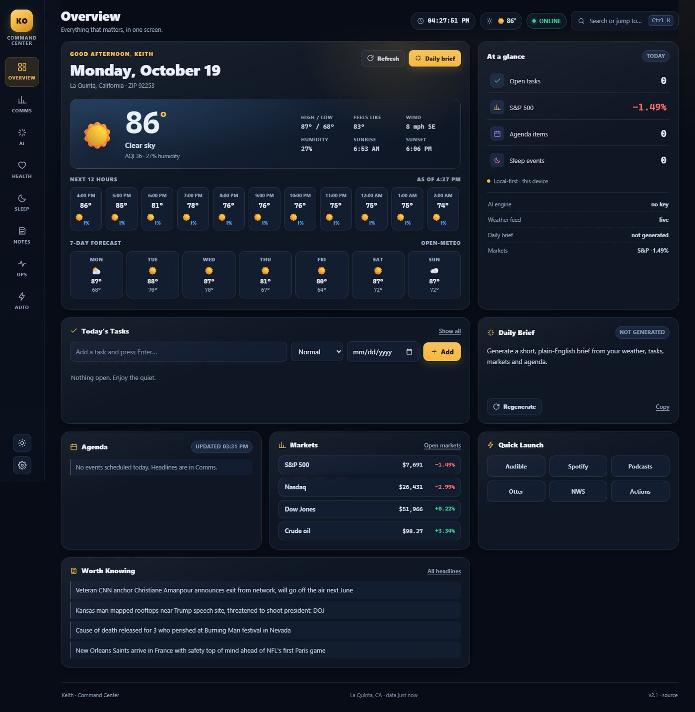
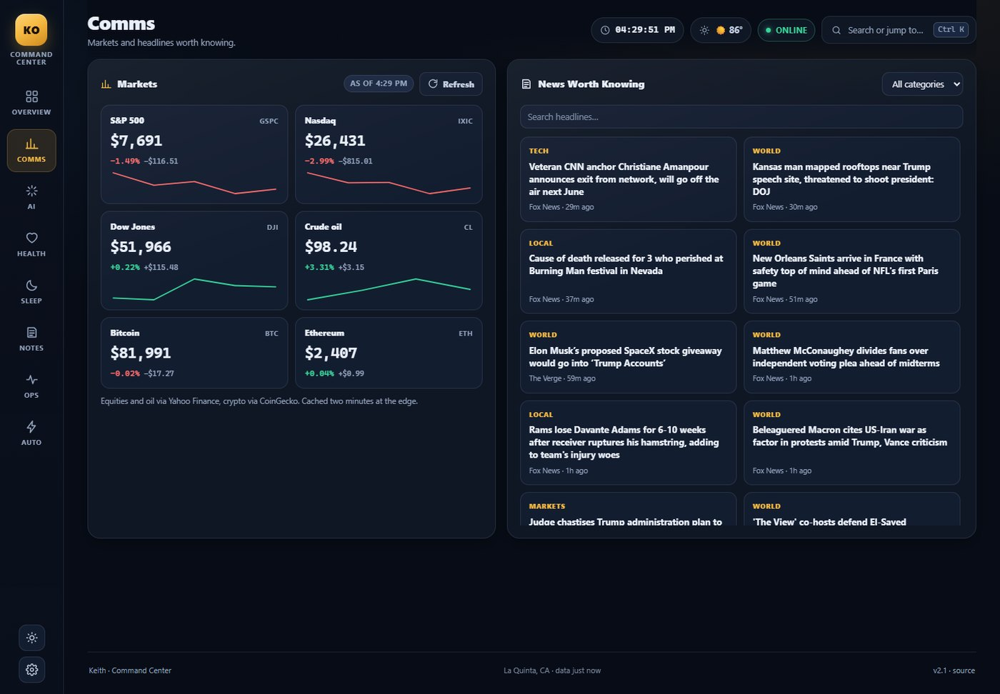
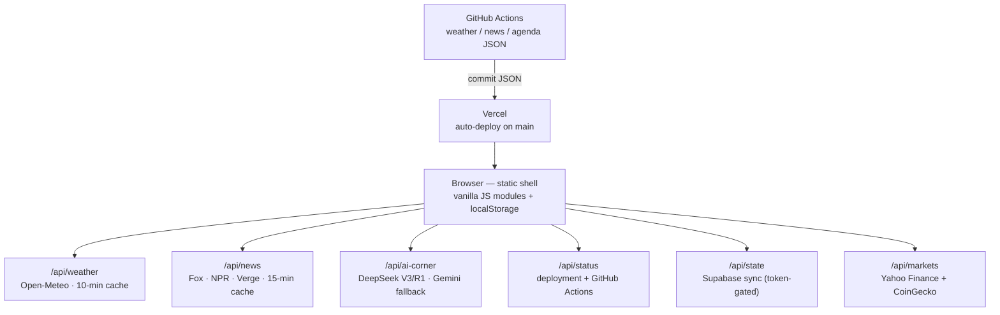

# Keith · Command Center

Keith Otter's personal command center for La Quinta, California — a heavy-duty replacement for the original n8n / Zapier / Supabase / Netlify dashboard. One screen for weather, tasks, markets, news, DeepSeek AI, health, sleep, notes, backups and deployment health.

**Live:** https://keith-otter.vercel.app
**Repo:** https://github.com/mathew1960/Keith-Otter
**Status:** v2.1 — static shell + Vercel serverless routes, no build step, local-first data.



| AI | Ops |
|---|---|
|  |  |

| Health | Mobile |
|---|---|
|  |  |



---

## What changed from v1

| Area | Before | Now |
|---|---|---|
| Layout | Seven stacked cards | Bento command center with 8 sections, command palette (`Ctrl K`), keyboard shortcuts, dark **and** light themes |
| AI | Gemini only, no streaming | **DeepSeek V3 / R1 primary**, Gemini fallback, token streaming, 4 presets, threads, usage + latency |
| Weather | Static JSON refreshed 4×/day | **Live Open-Meteo API** (`/api/weather`), 10-minute edge cache, hourly + 7-day + AQI + NWS alerts, falls back to the committed JSON |
| News | Static Fox headlines | **Live multi-feed aggregation** (`/api/news`) from Fox News, NPR and The Verge, categorised and searchable |
| Tasks | Text + done | Priority, due dates, filter, open/done counters, safe migration of old tasks |
| Notes | One textarea | Multiple markdown notes with preview, pinning, search and autosave |
| Health | Plaintext PIN in localStorage | **PBKDF2-hashed PIN**, meds with refill warnings, vitals with BP trend chart, notes |
| Sleep | Event list | Last-night summary, 14-night chart, CSV export, per-day notes |
| Ops | None | Service health checks, data-freshness table, latest GitHub Action runs, storage usage, backup export/import |
| Sync | None | **Optional Supabase cross-device sync** (`/api/state`) behind a shared token; fully local without it |
| Offline | None | PWA manifest + service worker offline shell |
| Scheduled jobs | Two crons raced and `Daily Agenda Builder` failed on push | Shared **concurrency group** + `git pull --rebase` retry in both workflows |
| Verification | Manual clicks | `npm test` — 20 HTTP/static checks + real Chrome UI checks + screenshots |

**v2.1:** SmarterMail was retired with its account, so the Email Watch card, the IMAP route and the `imapflow`/`mailparser` dependencies were removed and replaced by the live **Markets** card.

Old data is migrated automatically on first load (`keith_tasks`, `keith_notes`, `keith_meds`, `keith_sleep_events`, `keith_ai_chats`, `keith_health_pin`). Nothing is lost; the legacy keys are left untouched.

---

## Architecture



The dashboard is a **static shell** (`index.html` + `assets/`) with **no build step**. The `api/` folder is picked up by Vercel as Node serverless functions automatically.

---

## Panels

| Section | What it does |
|---|---|
| **Overview** | Greeting, live weather with hourly + 7-day strips, at-a-glance counters, tasks, AI daily brief, agenda, markets, quick launch, headlines |
| **Comms** | Live market grid with sparklines, and a news grid with category filter and search |
| **AI** | DeepSeek chat with streaming, model selector (V3 / R1), presets (research, brief, code, kitchen), saved threads, copy to notes |
| **Health** | PIN lock (PBKDF2), medications with refill countdowns, blood-pressure trend, vitals log, doctor's notes |
| **Sleep** | Apnea / gasping / snore / awake event logger, last-night summary, 14-night chart, CSV export |
| **Notes** | Markdown notes with write/preview tabs, search, pin, autosave |
| **Ops** | Per-service health checks with latency, data freshness, latest workflow runs, storage usage, sync setup, backup export/import, shortcuts |
| **Automations** | Status of GitHub, Vercel, DeepSeek, Supabase, n8n and Zapier, plus the full architecture diagram |

---

## API routes

| Route | Method | Purpose | Needs |
|---|---|---|---|
| `/api/weather` | GET | Live current/hourly/daily, AQI and active NWS alerts | nothing (Open-Meteo is keyless) |
| `/api/news` | GET | Merged, de-duplicated, categorised headlines | nothing |
| `/api/ai-corner` | GET / POST | DeepSeek chat (JSON or SSE stream) | `DEEPSEEK_API_KEY` (or `GEMINI_API_KEY`) |
| `/api/status` | GET | Env/integrations, deployment, GitHub runs, file freshness | optional `GITHUB_TOKEN` |
| `/api/state` | GET / PUT | Cross-device JSON snapshot sync | `SUPABASE_URL`, `SUPABASE_SERVICE_ROLE_KEY`, `DASHBOARD_SYNC_TOKEN` |
| `/api/markets` | GET | Live quotes: S&P 500, Nasdaq, Dow, crude oil, Bitcoin, Ethereum | none — public APIs |
| `/api/agenda-brief` | GET | Short DeepSeek greeting (legacy link compatibility) | same AI keys |

Every route degrades gracefully: a missing key returns a readable message, never a crash, and never exposes the key to the browser.

---

## Environment variables

Copy `.env.example` → `.env.local` for local work, and set the same names in **Vercel → Project → Settings → Environment Variables**.

| Variable | Required | Used by |
|---|---|---|
| `DEEPSEEK_API_KEY` | **yes** (AI) | `api/ai-corner.js`, `api/agenda-brief.js` |
| `GEMINI_API_KEY` | optional fallback | same |
| `SUPABASE_URL` | optional sync | `api/state.js` |
| `SUPABASE_SERVICE_ROLE_KEY` | optional sync | `api/state.js` (server only) |
| `DASHBOARD_SYNC_TOKEN` | optional sync | shared secret the browser sends as `x-sync-token` |
| `GITHUB_TOKEN` | optional | raises GitHub API limits in `api/status.js` |
| `N8N_WEBHOOK_URL` | optional | reported in the Automations panel |

> The previous Gemini model name (`gemini-3.6-flash`) is kept as the fallback constant in `api/ai-corner.js`. DeepSeek is now primary.

---

## Deployment

Vercel is already connected to `mathew1960/Keith-Otter` and deploys every push to `main`.

1. **Merge the v2 branch** into `main` (or push to it).
2. Vercel builds automatically — no build command, root `index.html` + `api/` functions.
3. **Set `DEEPSEEK_API_KEY`** in Vercel → Settings → Environment Variables (Production + Preview), then redeploy once.
4. Open https://keith-otter.vercel.app and check:
   - weather renders and updates (live API, not the old 4×/day file),
   - **AI** answers,
   - **Ops** shows all green except "Sync (Supabase)" if you have not set it up.
5. Optional: cross-device sync — run [`automation/supabase/schema.sql`](automation/supabase/schema.sql) in Supabase, add the three env vars, then paste the same token into **Ops → Storage & sync** on each device.
6. Optional: n8n — import [`automation/n8n/keith-command-center.json`](automation/n8n/keith-command-center.json), set `SUPABASE_URL` / `SUPABASE_SERVICE_KEY` in n8n, activate.
7. Optional: Zapier — see [`automation/zapier/README.md`](automation/zapier/README.md).

### Rollback

The previous dashboard is one commit back on `main`. Either `git revert` the v2 merge or redeploy the earlier Vercel deployment from the Deployments tab. Local data is untouched (v2 only adds `kc.v2.*` keys).

---

## Local development

```bash
# static + api routes on http://127.0.0.1:4310
node tests/dev-server.mjs

# full verification: 20 HTTP/static checks + Chrome UI checks + screenshots
node tests/run.mjs

# smoke only (no browser)
node tests/run.mjs --smoke

# accessibility audit with axe-core across all views
node tests/a11y.mjs
```

Browser checks need `puppeteer-core` (installed in `tests/`, deliberately kept out of the root `package.json` so Vercel does not install it):

```bash
cd tests && npm install
```

Artifacts land in `tests/artifacts/` — screenshots and `report.json`.

The AI route is verified with **no key set**: it must answer 200 with a clear “add `DEEPSEEK_API_KEY`” message rather than fail. With a key in `.env.local` the same checks exercise the real model.

---

## Data & privacy

- Tasks, notes, meds, vitals, sleep log, chats, health notes and settings live in **this browser** (`localStorage`), namespaced `kc.v2.*`.
- The health PIN is stored as a **PBKDF2-SHA256 hash** (150k iterations, random salt), never plaintext. It is a screen lock, not disk encryption.
- Sync is off by default. When enabled, snapshots go to your own Supabase project and are protected by RLS + a server-side service key; the browser only ever holds the sync token.
- The AI key lives only in Vercel env vars. The browser calls `/api/ai-corner`.

---

## Verification (v2.1)

Last run in this workspace: **all checks passed** — see `tests/artifacts/report.json`.

- 20 HTTP/static checks: shell, assets, manifest, service worker, duplicate-ID scan, UI-binding scan, JSON data files, every API route, JS syntax, workflow race guard, automation assets.
- 15 real-browser checks in Chrome: weather render, task add/delete, command palette navigation, AI reply, health unlock + medication + PIN lockout, markdown notes, theme toggle, ops checks, mobile bottom nav switching, offline shell after reload, zero console errors.
- **Accessibility:** 0 WCAG 2.1 A/AA violations across 7 views (axe-core 4.14, `npm run test:a11y`).
- **Live DeepSeek check:** with a key in the local dev server env, `/api/ai-corner` returned `provider: deepseek` and streamed SSE deltas (74 prompt / 87 total tokens for a smoke prompt). The daily brief and the AI panel both rendered real replies — screenshots `08-overview-brief.png` and `10-ai-real.png`.
- Screenshots: `tests/artifacts/01-overview-dark.png`, `04-overview-light.png`, `02-ai.png`, `03-notes.png`, `05-ops.png`, `06-mobile.png`, `07-health.png`.

---

## Repo map

```
index.html                 dashboard shell
assets/                    styles.css, core.js, panels.js, app.js, icons/
api/                       weather, news, markets, ai-corner, status, state, agenda-brief
automation/supabase/       schema.sql for optional sync
automation/n8n/            importable n8n workflow
automation/zapier/         Zap setup notes
automation/netlify/        Netlify alternative notes
tests/                     dev-server, smoke, UI harness, screenshots
.github/workflows/         existing scheduled JSON jobs + CI verification
scripts/                   Python fetchers used by the scheduled workflows
output/, agenda/           JSON/text the workflows commit
production/, r-and-d/      legacy n8n/Zapier reference files (not used at runtime)
docs/screenshots/          README images
```

### Legacy stack note

The original project was an n8n / Zapier / Supabase / Netlify automation hub for Fortun's Kitchen + Bar. v1 removed that stack in favour of GitHub Actions + Vercel. v2 keeps it deliberately optional: the dashboard runs with **zero** external automation, and each of those platforms can be layered back on without changing the shell. `production/` and `r-and-d/` are reference configs only.

---

*La Quinta, CA · built for Keith Otter*
